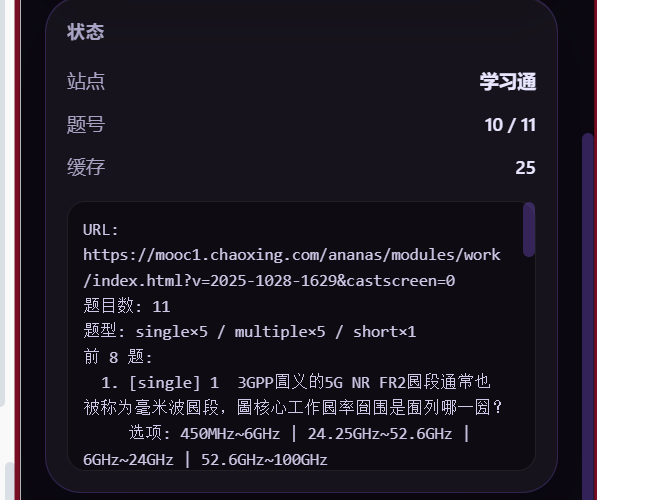

<p align="center">
  
</p>

<h1 align="center">题灵 Quizora</h1>

<p align="center">在已打开的答题页面上自动识别整卷题目、调用大模型判题并填写答案 —— 不自动交卷。</p>

<p align="center">
  
  
  
  
</p>




> 截图为 0.5.2 学习通混合卷实测：识别 11 题（单选×5 / 多选×5 / 简答×1），完成 10 道客观题。0.6.0 改为按学习通真实填空结构 `.XztiHover1` 写入并内置 `font-cxsecret` 字体解密；0.7.4 恢复头歌自动答题（实验），同时保留 0.7.3 的粘贴解锁与平台标识。

## 简介

题灵（Quizora）是一个基于 **Manifest V3** 的 Edge / Chrome 浏览器扩展。它不依赖刷新页面，直接接管**当前已经打开**的答题页：扫描整页题目 → 调用你配置的大模型判题 → 自动点击选项或写入填空/简答 → 你在确认后手动提交。

项目最初为 Wayground 实时对局而写，后扩展到学习通整卷（练习/作业/章节测验）、头歌（EduCoder）自动答题与粘贴解锁、以及任意可作答网页。

## 核心功能

- **整卷扫描**：一次识别页面上的全部题目，而不是只处理当前一题。
- **结构无关识别**：容器选择器 + 题型标签 + `typeName` 属性 + 答题控件反推，多路合并去重。
- **头歌（EduCoder）自动答题（实验）+ 粘贴解锁**：点“开始”可自动生成/写入/评测并进入下一关；同时页面加载时已改写任务 API 的 copy 标志并清理 `onpaste`，自动答题失败也能直接粘贴自己的代码手动评测。侧边栏显示“头歌（EduCoder） / 自动答题（实验）+ 粘贴解锁”，页面右上角有平台徽标。
- **多题型支持**：单选、多选、判断、填空（多空）、简答/论述/名词解释。
- **图片题**：题目内图片可随题干一起发送给视觉模型（最多 2 张，长边 1024）。
- **大模型判题**：兼容 OpenAI 接口，默认 DeepSeek；支持自定义 Base URL、模型与 Key。
- **跳过已作答**：按页面 URL 隔离记录，开启后不覆盖已有答案。
- **演练模式**：只显示建议、不写入答案，默认开启。
- **不自动提交**：填完后提示检查并手动交卷。
- **诊断能力**：探测快照、各 frame 汇总、注入自检、单题异常日志。

## 支持的浏览器与网站

### 浏览器

| 浏览器 | 支持情况 |
| --- | --- |
| Microsoft Edge（Chromium） | 支持，推荐 |
| Google Chrome | 支持（需 Side Panel，建议 114+） |
| 其他 Chromium 浏览器 | 未验证 |

### 网站

| 站点 | 支持内容 | 当前状态 |
| --- | --- | --- |
| 学习通（超星，`*.chaoxing.com`） | 整卷扫描、单选/多选/判断/填空、简答、图片题、跳过已作答 | 混合卷识别与客观题填写已在真机验证；多空填空已修复；简答写入待复测 |
| Wayground / Quizizz | 单题识别、选项点击、文本输入 | 历史真机可用；当前版本待回归 |
| 通用网页（任意 http/https） | radio/checkbox、纯文本 A/B/C/D 选项、textarea/contenteditable | 本地 mock 验证；真实站点样本有限 |

> 不支持的题型：连线、拖拽排序、编程题、听力题；Wayground 的多选与图片题也不支持。

## 安装

### 方式一：使用发布包（推荐）

1. 下载安装包：[GitHub Release v0.7.6](https://github.com/kingdome55/Quizora/releases/download/v0.7.6/quizora-v0.7.6.zip)（备用：[仓库内 ZIP](release/quizora-v0.7.6.zip)）。
2. **完整解压**到一个固定目录，例如 `D:\Quizora\`。解压后该目录里应直接看到 `manifest.json`。
3. 打开 `edge://extensions`（Chrome 为 `chrome://extensions`）。
4. 打开右上角“开发人员模式”。
5. 点击“加载解压缩的扩展”，选择解压后的目录。
6. 点击工具栏中的“题灵”图标，打开侧边栏。

> GitHub Releases 提供每个版本的 ZIP 与更新说明，页面：https://github.com/kingdome55/Quizora/releases

### 方式二：源码加载（开发）

```powershell
git clone https://github.com/kingdome55/Quizora.git
```

> 仓库地址：https://github.com/kingdome55/Quizora

打开扩展管理页 → 开发人员模式 → 加载解压缩的扩展 → 选择仓库根目录（含 `manifest.json`）。

## 使用

1. 打开答题页面，保持标签页处于激活状态。
2. 打开侧边栏，填写 API Base URL（默认 `https://api.deepseek.com/v1`）、API Key、模型，点“保存”。
3. 点“测试连接”，确认返回正常。
4. 点“探测当前页”，核对题目数、题型与前 8 题是否与页面一致。
5. 保持“演练模式”开启，观察建议；确认无误后关闭演练。
6. 点“开始”，等待进度到 `X/Y`。
7. **检查答案后手动提交**。扩展不会点交卷。
8. 随时可用侧边栏“停止”、页面左下角 HUD 或快捷键 `Alt+Shift+S` 中断。

> 修改扩展代码或重新加载扩展后：扩展页“重新加载” → 关闭并重开侧边栏 → 目标页面 `Ctrl+F5` → 重新探测。

## 权限说明

| 权限 | 用途 |
| --- | --- |
| `scripting` | 向当前页面注入答题脚本 |
| `storage` | 本地保存配置、答案缓存与“已处理题目”记录 |
| `tabs` / `activeTab` | 获取当前标签页与 URL，判断站点 |
| `sidePanel` | 侧边栏控制台 |
| `webNavigation` | 枚举页面内所有 frame，定位题目真正所在的 iframe |
| `host_permissions`（全部 http/https） | 支持“任意网页”兜底；学习通/Wayground 也需要对应域名 |

- API Key 只保存在本机 `chrome.storage.local`，不会上传到本项目服务器（项目没有服务器）。
- 题目文本与图片会直接发送到**你配置的**大模型 API。
- 全站权限是当前“通用网页”能力的代价；如只需要学习通，可在 `manifest.json` 中收窄 `host_permissions`。

## 常见问题

**Q：会自动交卷吗？**  
A：不会。扩展只填写，提交由你手动完成。

**Q：为什么探测是 0 题？**  
A：先看状态是“未获取到页面信息”还是“识别到 0 道题”。前者是内容脚本未响应（重载扩展后需刷新页面）；后者看探测面板的“容器命中 / typeName / 各 frame”诊断。

**Q：学习通简答题写不进去？**  
A：0.5.2 真机在最后一题报 `Illegal invocation`，0.5.3–0.6.0 已做跨 frame 修复，待真机复测。若仍失败，日志会显示 `第 N 题写入异常：…`。

**Q：题干出现“庝/庡/庤”乱码？**  
A：学习通 `font-cxsecret` 字体反爬。0.6.0 内置 Typr.js + 字形映射表，在扫描前解密题干与选项；日志出现“字体解密已就绪：N 个字形”即表示生效。若映射表未命中，会保留原文，不影响其他功能。

**Q：头歌（EduCoder）怎么用？**  
A：打开头歌任务页（可直接打开，也可在学习通内嵌页）。插件会同时做两件事：① 自动解除粘贴限制；② 在侧边栏点“开始”运行自动答题（实验）。日志出现“头歌（EduCoder）已识别”后，你可以直接粘贴自己的代码手动评测；也可以点“开始”让插件自动生成/评测/进入下一关。侧边栏“站点”显示头歌（EduCoder）、“模式”显示自动答题（实验）+ 粘贴解锁。考试页（URL 含 `/exam`）既不自动作答也不解锁粘贴。

**Q：可以用于正式考试吗？**  
A：不建议。自动答题可能违反平台规则，账号与成绩风险由使用者承担。项目不做风控规避，也不自动提交。

**Q：Key 安全吗？**  
A：Key 仅存本机扩展存储，明文保存；不要在共用电脑上使用，也不要提交到仓库或截图。

## 技术栈

- Manifest V3（Service Worker + Side Panel + Content Scripts）
- 原生 JavaScript / HTML / CSS，**无框架、零构建依赖**；仅内置字体解析所需的最小第三方库（见“第三方组件”）
- 头歌双能力：`document_start` 的 MAIN world 脚本 hook `fetch` 改写任务 API copy 标志并清理 `onpaste/user-select`；`document_idle` 的 `edu-main` 负责自动答题（Monaco/DOM 编辑器读写、评测、下一关、刷新续跑）
- OpenAI 兼容 Chat Completions 接口（支持 `image_url` 多模态）
- `chrome.scripting`、`chrome.webNavigation`、`chrome.storage.local`

## 目录结构

```
manifest.json            扩展声明（图标、权限、学习通静态内容脚本）
assets/                  品牌图标 16/48/128 与 1024 源图
src/background.js        Service Worker：路由、注入、运行态、自检
src/background/          配置、缓存、LLM、站点注册、frame 选择
src/content/             Wayground 单题链路 + 学习通/通用整卷链路 + 字体解密 + 头歌编程链路（edu-adapter/edu-main）
src/vendor/              Typr.js / md5 / 学习通字形映射表（第三方，见下）
src/panel.*              侧边栏控制台
docs/                    架构、踩坑、决策、测试、遗留问题
docs/archive/            早期方案原文（历史资料）
scripts/build.ps1        生产构建：校验 + 组装 + ZIP
release/                 发布包（ZIP）
```

## 开发与构建

```powershell
# 语法与 manifest 校验
Get-ChildItem -Recurse -File -Filter *.js | ForEach-Object { node --check $_.FullName }
Get-Content manifest.json -Raw | ConvertFrom-Json | Out-Null

# 生产构建（生成 dist/ 与 release/quizora-v0.7.6.zip）
powershell -ExecutionPolicy Bypass -File scripts/build.ps1
```

构建说明见 [docs/BUILD_AND_TEST.md](docs/BUILD_AND_TEST.md)，完整安装教程见 [docs/INSTALL.md](docs/INSTALL.md)。

## 版本与计划

- 版本记录：[CHANGELOG.md](CHANGELOG.md)
- 已知问题：[docs/KNOWN_ISSUES.md](docs/KNOWN_ISSUES.md)
- 下一阶段计划：[docs/NEXT_STEPS.md](docs/NEXT_STEPS.md)
- 完整知识库：[docs/README.md](docs/README.md)

## 参与贡献

- 贡献指南：[CONTRIBUTING.md](CONTRIBUTING.md)
- 安全问题：[SECURITY.md](SECURITY.md)
- Issue / PR 模板位于 `.github/`

## 开源协议

本项目采用 [MIT License](LICENSE)。你可以自由使用、修改与分发，但需保留版权与许可声明。

### 第三方组件

学习通字体解密参考并内置了以下 MIT 许可组件/数据：

- [Typr.js](https://github.com/photopea/Typr.js)（字体解析，MIT）
- [blueimp-md5](https://github.com/blueimp/JavaScript-MD5)（MD5，MIT）
- 字形映射表 `cx-font-table.json`（作者 wyn665817，MIT；与 [OCSJS](https://github.com/ocsjs/ocsjs) 使用的 `table.json` 相同）
- 解密思路参考 [超星字体解密](https://scriptcat.org/zh-CN/script-show-page/432)（MIT）与 [OCSJS](https://github.com/ocsjs/ocsjs)

填空结构参考 [cxmooc-tools](https://github.com/CodFrm/cxmooc-tools)：答案格 `.XztiHover1`，格内为 `input.inp` 或 UEditor。

## 免责声明

本项目仅用于学习、自测与复习场景。请遵守所在平台的使用条款与学术规范；因使用本工具产生的账号、成绩或其他风险由使用者自行承担。
